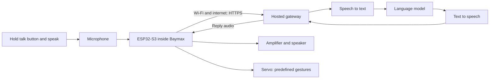

# Mini Baymax: researched build plan

> **Current decisions — 29 September 2026:** The robot is now **150 mm tall**, with two independently moving arms and a turning head (three servos planned; one owned). Cameras are postponed. ESP32-S3 N16R8 firmware has been uploaded and the authenticated laptop server connection returned HTTP 204. Physical audio and motor tests remain pending; the microphone/amplifier are due October 3 and a suitable motor power supply is still needed. The editable Blender enclosure draft is in `mechanical/blender/`; read its README before printing. Mechanical mounts and component clearances are not final. The older 17 cm / single-arm design and implementation status below are historical and superseded by this update and `MECHANICAL_LAYOUT.md`.

Research date: 28 September 2026. Status: working laptop conversation and accepted voice experiment; standalone gateway, firmware, circuit and CAD still need implementation and physical validation.

## Current implementation update

The laptop prototype runs local Ollama Qwen3, faster-whisper transcription and Sopro voice generation; the user accepted its smoother Baymax-inspired voice. See [START_HERE.md](C:/Users/dhruv/OneDrive/Desktop/Baymax/START_HERE.md). Eleven automated tests pass, and local text, transcription and speech endpoints have been exercised. The voice's exact match to the film is not verified. The user now accepts a **laptop-on first hardware version**, with cloud hosting later. The three essential hardware candidates can be purchased for that stage once the listings, existing servo and power source are checked. Firmware, a secure local-network device endpoint and fitted CAD remain future work; the current web server is bound to localhost and cannot yet accept ESP32 requests.

## Decision

Build a stationary, approximately 17 cm tall desk companion with a white printed shell, microphone, speaker, talk button, power switch, and one gently waving arm. Add the second arm after the first works.

The finished robot must operate with the user's computer switched off. Develop first with an ESP32-S3 inside Baymax and the laptop doing speech recognition, conversation and speech generation over local Wi-Fi. Later move the same device protocol to an internet-hosted service. Target INR 3,000 in additional hardware. Internet/API running costs are separate.

The user already owns a **Bambu Lab P1S** and **Arduino Uno R3**. Six photos supplied on 28 September show a micro servo, two breadboards, jumper wires, LEDs, resistors and other starter-kit modules. See [the photo inventory](C:/Users/dhruv/OneDrive/Desktop/Baymax/PARTS_INVENTORY.md). Reuse the existing servo after testing; the final robot can use only the ESP32-S3. The essential additional-parts total is INR 1,707.06 at previously checked Amazon prices. Existing cables, switches, connectors and mounting parts are reused as confirmed by the user. Printing is excluded. A new adapter is conditional, not part of the essential basket. See [purchase checks and Amazon links](C:/Users/dhruv/OneDrive/Desktop/Baymax/AMAZON_PURCHASE_PLAN.md). This is not a tested prototype or a guarantee of success.

**The accepted voice is a local experiment, not an official movie voice.** A standalone deployment of that voice is unresolved. The ESP32-S3 will handle audio and motion, while larger models must run on a hosted computer/server if the personal laptop is off.

## Requirements and boundaries

- Final requirement: power adapter plus Wi-Fi/internet, no running personal computer. First hardware version temporarily requires the laptop on the same Wi-Fi.
- Back-and-forth spoken conversation, initially by holding a button to talk.
- Calm, patient behavior; chosen startup greeting and a gentle wave.
- Small fixed body, fixed head and feet, one moving shoulder initially.
- Serviceable printed enclosure and replaceable modules.
- Essential purchase estimate INR 1,707.06; INR 2,186.06 only if a new adapter is needed. Delivery and online-service costs are separate.
- A computer remains necessary for development, voice auditioning, CAD and firmware flashing.
- Rigid printed plastic for version one. Walking, inflatable softness, battery power and medical sensors are future projects.
- Still needed: existing adapter's output voltage/current/polarity, servo model and operation check, available white filament and tools, desired height, preferred spoken language, and an acceptable voice sample.

## How conversation works



The ESP32 records and plays sound and controls movement. The language model chooses words; the speech synthesizer determines how those words sound. These are separate components.

Wi-Fi connects to the router; internet access reaches the hosted services. Without internet, Baymax can still wave and play cached greetings or a connection-error message, but cannot provide arbitrary conversation with this design.

An Uno R3 has only 2 KB SRAM and no built-in Wi-Fi. It cannot run the conversational system envisioned here. Use it to learn servo control while building the cloud pipeline. [Arduino Uno R3](https://store.arduino.cc/products/arduino-uno-rev3)

Choose an ESP32-S3 development board with verified PSRAM, such as an N16R8 variant: 16 MB flash and 8 MB PSRAM. An arbitrary listing titled “ESP32” is not equivalent. Espressif documents I2S audio and HTTPS support. [Module datasheet](https://www.espressif.com/sites/default/files/documentation/esp32-s3-wroom-1_wroom-1u_datasheet_en.pdf), [I2S driver](https://docs.espressif.com/projects/esp-idf/en/stable/esp32s3/api-reference/peripherals/i2s.html), [HTTP client](https://docs.espressif.com/projects/esp-idf/en/stable/esp32s3/api-reference/protocols/esp_http_client.html)

An official Espressif OpenAI demo is a useful reference, but targets particular audio boards. Our generic microphone/amplifier needs custom integration; it is not a guaranteed unchanged demo installation. [Espressif demo](https://github.com/espressif/esp-webrtc-solution/blob/main/solutions/openai_demo/README.md)

## Voice: test this first

The three independent goals are recognizable appearance, familiar behavior and vocal identity. The first two are straightforward design work. The third must be demonstrated with audio.

1. Audition short greetings and fresh conversational sentences on the computer.
2. For an approximation, try a calm built-in synthetic voice with measured pacing and short pauses. A prompt cannot fully replace voice design.
3. OpenAI's instruction-capable TTS and ElevenLabs voice design are possible audition tools, not confirmed Baymax matches.
4. If only the original movie voice is acceptable, keep this requirement open until a suitable authorized voice source/service is established.

No consulted official source establishes an available licensed Baymax voice model. OpenAI custom voices require eligible access plus a voice-owner consent recording and sample; hobby-account access is not assured. ElevenLabs Instant Voice Cloning also requires rights and consent. [TTS guide](https://developers.openai.com/api/docs/guides/text-to-speech), [voice prompting](https://developers.openai.com/api/docs/guides/voice-prompting), [custom voices](https://developers.openai.com/api/docs/guides/custom-voices), [ElevenLabs requirements](https://elevenlabs.io/docs/eleven-creative/voices/voice-cloning/instant-voice-cloning)

A cached greeting such as “Hello. I am Baymax, your personal healthcare companion.” is easy once the voice is selected. A recording of one greeting does not provide the voice for arbitrary new replies.

The character behavior can be calm, literal, patient and concise. The robot should not claim it has medically scanned the user, measured vital signs, or diagnosed an illness.

## Hardware budget

Prices below were observed on Amazon India on 28 September 2026; they were not refreshed for this revision. The user confirms cables, switches, connectors and mounting parts are already available. Reuse them; do not order duplicates. Printing and contingency are not purchase items.

| Essential missing item | Previously observed price |
|---|---:|
| AYWHP ESP32-S3 N16R8 development board | INR 999 |
| OceanLabz INMP441 microphone + MAX98357A amplifier combo | INR 469.06 |
| Electronic Spices 2-inch, 4-ohm, 3 W speakers, pack of two; only one speaker required | INR 239 |
| **Essential additional-parts total** | **INR 1,707.06** |

Reuse the existing servo, wires, switches, connectors and mounting supplies. The speaker listing is a two-pack; a second speaker is not required electrically. One compatible speaker can replace the pack if sourced for less.

A suitable supply is necessary, but buying another is not yet justified. Check the existing adapter's output voltage, current and polarity first. The previously checked Callsa 5 V, 3 A candidate costs INR 479, making the total INR 2,186.06 only if replacement is needed. Its connector and polarity also require confirmation. No blanket assembly or contingency allowance is included. Check any actual missing or incompatible item individually before proposing a purchase. Delivery, price changes and online-service costs are separate.

Existing servo operation remains unverified. Basic tools must be available or borrowed. The kit's breadboard regulator is not yet qualified to supply the robot. Measure the nominal 2-inch speaker before CAD. No new custom PCB, second controller, display, battery or second servo is needed for the first one-arm version.

The photographed bag is labelled ESP8266 ESP-01. This is useful for Wi-Fi experiments but has far fewer accessible pins and much less working memory than the proposed S3 board; retain the ESP32-S3 for the planned audio capture/playback design. The red microphone/comparator board appears to be a KY-038-style sound detector. Such boards have a threshold output and may expose analog microphone output, but are not drop-in replacements for an I2S speech microphone. Its exact model and performance are unverified. [Espressif ESP8266 datasheet](https://documentation.espressif.com/0a-esp8266ex_datasheet_en.html), [Joy-IT sound-sensor description](https://sensorkit.joy-it.net/en/sensors/ky-038)

Direct listing observations on the research date:

| Part | Observed price | Source |
|---|---:|---|
| ESP32-S3 N16R8 | INR 760, GST included; in stock shown | [Wavtron](https://www.wavtron.in/products/esp32-s3-devkitc-n16r8-dev-board) |
| INMP441 | INR 164; in stock shown | [Electrobot](https://store.electrobot.co.in/product/inmp441) |
| MAX98357A | INR 105, GST included; in stock shown | [StemVolt](https://stemvolt.in/product/max98357a-i2s-3w-class-d-audio-decoder-amplifier-module/) |
| 40 mm speaker | INR 67.80, tax included | [Robogears](https://www.robogears.in/hi/shop/audio-video-speakers-98/012020-4ohm-40mm-diameter-3w-full-range-audio-speaker-2986) |
| SG90 | INR 96, GST included; in stock shown | [Robocraze](https://robocraze.com/products/sg90-micro-servo-motor) |
| 5 V, 3 A adapter | INR 499 on category page; product stock not independently confirmed | [Robu product](https://robu.in/product/pro-range-5v-3a-power-adapter), [category](https://robu.in/product-category/batteries/single-output-power-supply-adaptor/power-supply-adapter/) |

Prices and availability can change. These listings demonstrate plausible pricing, not independently verified seller quality. Check module variant, delivery, tax and final checkout total before ordering.

## Recurring cost, separate from hardware

A calculable **standard-voice** cloud baseline is:
- Speech recognition: gpt-4o-mini-transcribe.
- Text replies: GPT-4.1 mini.
- Speech generation: tts-1.

This is a cost example, not a Baymax voice recommendation. tts-1 supports speed adjustment but not voice-style instructions. An instruction-capable or custom-voice service has different pricing. [Speech API parameters](https://developers.openai.com/api/reference/cli/resources/audio/subresources/speech/methods/create)

Assume 10 interactions/day for 30 days, each with 10 seconds recorded input, 1,000 LLM input tokens including bounded history, 80 output tokens, and 400 spoken characters.

| Component | Calculation | Monthly |
|---|---|---:|
| Transcription | 50 min x USD 0.003/min | USD 0.15 |
| Text model | 0.3M input x USD 0.40/M + 0.024M output x USD 1.60/M | USD 0.1584 |
| Speech generation | 0.12M characters x USD 15/M | USD 1.80 |
| **Total** | Before taxes, retries, exchange fees and hosting | **USD 2.1084** |

[Transcription pricing](https://developers.openai.com/api/docs/pricing), [GPT-4.1 mini pricing](https://developers.openai.com/api/docs/models/gpt-4.1-mini), [TTS-1 pricing](https://developers.openai.com/api/docs/models/tts-1)

For budgeting only, at an assumed INR 100/USD this is about INR 211 before tax/fees. This is not a live exchange quote. Allowing roughly INR 300/month is a reasonable starting envelope for this particular usage and standard voice, subject to actual bills. Thirty equivalent interactions/day would triple usage. Longer answers increase speech costs. Provider funding minimums may exceed the first month's actual consumption.

A thin Cloudflare Worker is a candidate gateway. Its free plan allows 100,000 requests/day but has a 10 ms CPU limit and 128 MB memory per isolate. Network waiting does not count toward CPU time. Keep it to authentication, small text processing and audio forwarding; run no speech models or audio transcoding there. Benchmark before promising free-tier compatibility. Paid Workers start at USD 5/month; this would materially increase running cost. Storage and usage-counter choices must also fit applicable limits. [Workers limits](https://developers.cloudflare.com/workers/platform/limits/), [Workers pricing](https://developers.cloudflare.com/workers/platform/pricing/)

## Software and interaction plan

Start with **hold-to-talk**, rather than continuous listening:
1. Power on, connect, play a cached greeting.
2. Hold the chest button to record, up to 20 seconds.
3. Release to upload; indicate “thinking” with a small status light.
4. Play the short answer and optionally wave.
5. Return to ready.

Microphone capture is inactive during playback; keep the arm still during recording. Wake words, automatic turn detection and speaking interruptions are later features.

States: OFF, STARTING, READY, LISTENING, THINKING, SPEAKING, ERROR. On failure, stop gestures, bound retries and recover to ready with an honest status indication.

Proposed code:
- C++ firmware using the Arduino framework for ESP32-S3.
- A small TypeScript hosted gateway with separate STT, LLM and TTS adapters.
- HTTPS upload of a bounded WAV file; response audio streamed back.
- Only predefined gestures such as wave/rest/none. Firmware owns safe angles, speed and timeouts; the LLM never sends executable code or unrestricted servo angles.

At 16 kHz, 16-bit mono, a 20-second recording uses 640,000 bytes plus a WAV header. Store bulk audio in PSRAM, with appropriate internal I2S/DMA buffers. This fits nominal capacity, but Wi-Fi/TLS buffers and runtime memory still need profiling. Convert INMP441's native sample format correctly. Upload with a known Content-Length in small writes; avoid base64 expansion. Return a fixed PCM format, such as 24 kHz signed 16-bit mono, and match playback settings to it. [External RAM restrictions](https://docs.espressif.com/projects/esp-idf/en/stable/esp32s3/api-guides/external-ram.html), [TTS formats](https://developers.openai.com/api/docs/guides/text-to-speech)

Keep provider keys in server-side secrets. Give the device a restricted, revocable credential, validate TLS certificates, and enforce input size, request rate, answer length and usage limits. Do not store raw recordings by default. Persistent usage accounting needs persistent storage; a serverless function's temporary memory is insufficient. Provider alerts alone are not a hard spending cap. [Cloudflare secrets](https://developers.cloudflare.com/workers/configuration/secrets/)

Initial latency might be around 2–8 seconds after releasing the button, with longer waits possible. This is an engineering estimate, not a tested result or guarantee. Measure it before optimizing. No LLM fine-tuning is required initially.

## Electronics and power

Conceptual topology, **not a pin-by-pin schematic**:

```text
Enclosed regulated adapter -> rated DC switch -> power distribution
                                                |-> servo supply branch
                                                |-> amplifier supply branch
                                                |-> board's approved input
Board 3.3 V ---------------------------------------> microphone
Circuit grounds ----------------------------------- common reference
```

A good 5 V, 3 A adapter is a starting candidate for one light servo. Verify actual combined demand, supply voltage and brownouts before adding a second. Servo current must not pass through a GPIO or the board's small regulator. Share grounds. During Uno USB experiments, keep external servo positive separate from the Uno's supply. [Arduino servo power](https://support.arduino.cc/hc/en-us/articles/360017053760-Troubleshoot-servo-motors)

Use short, secured power wiring and appropriate connectors. Consider correctly polarized bulk capacitance near the servo after selecting the circuit; it does not replace an adequate adapter.

INMP441 uses 3.3 V. ESP32 GPIO is not 5 V tolerant. Verify that the chosen servo recognizes 3.3 V control; budget a buffer if necessary. Connect the MAX98357A speaker across its two speaker outputs: **neither speaker lead goes to ground**. [Microphone datasheet](https://invensense.tdk.com/wp-content/uploads/2015/02/INMP441.pdf), [amplifier pinouts](https://learn.adafruit.com/adafruit-max98357-i2s-class-d-mono-amp/pinouts)

Check the exact development board's power path. Espressif documents USB, 5 V pins and 3.3 V pins as mutually exclusive supply methods for DevKitC. Do not attach external power and programming USB simultaneously until that board's isolation is verified. A true off state also requires eliminating alternate USB power. [DevKitC power](https://documentation.espressif.com/esp-dev-kits/en/latest/esp32s3/esp32-s3-devkitc-1/user_guide_v1.0.html)

A custom chip or PCB is unnecessary. Use modules first; a tidy carrier PCB can follow once the working circuit and mounting positions are fixed.

## Printable enclosure

The P1S has a nominal 256 x 256 x 256 mm build volume, comes with a 0.4 mm nozzle, and supports PLA. A split 170 mm figure fits comfortably; no printer upgrade is needed. [Official P1S specifications](https://store.bblcdn.com/s5/default/78c105c0c92642a99e64b4b0b0f3ca6a.pdf)

Starting dimensions, subject to component layout:

| Part | Concept envelope |
|---|---|
| Total figure | 170 mm tall, approximately 120 mm wide with arms down |
| Torso | 85–95 mm wide x 65–75 mm deep |
| Head | Approximately 55 x 38 x 35 mm |
| Arms | 55–65 mm long, hollow |
| Feet/base | Approximately 95–105 x 75–85 mm |

Use removable front/rear torso pieces, a fixed head, separate arm shells, fixed feet, an internal tray and screw-accessible service openings. Keep electronics low, provide rear cable strain relief and rubber feet, and test stability with the arm raised.

Place the speaker grille in the belly and give the microphone an opening aligned with its actual sound port, away from the speaker and servos. Leave space for connectors, cable bends and the antenna. Black eye inserts or paint plus a chest status light avoid needing a display.

Fasten the arm to the servo's supplied horn; do not print its tiny spline. Preserve access to the horn screw. Mount by the servo tabs and support sideways loads with a coaxial pivot/bushing if needed. Target a 20–35 g arm. A 30 g arm with its centre of mass 4 cm from the shoulder creates about 0.12 kg·cm static torque, before friction and acceleration.

TowerPro lists its SG90 digital at 9 g and 1.8 kg·cm stall torque at 4.8 V, with a nominal 23 x 12.2 x 29 mm body envelope. Generic SG90-labelled parts vary. Measure the actual body, tabs, horn and cable before final CAD; stall torque is not normal operating torque. [TowerPro SG90](https://towerpro.com.tw/product/sg90-7/)

Calibrate a slow gesture covering about 45–60 degrees initially; never assume universal 180-degree travel. Clamp angles before shell collisions and motor endpoints. Physical stops are backup protection, not positions to push against continuously.

Start in Bambu Studio with the P1S profile matching the actual nozzle/filament, approximately 0.2 mm layers and 1.8–2.0 mm shell walls, with stronger local mounting bosses. Use M2/M3 screws and captured nuts where practical. Split curved shapes to reduce support scars. Print a shoulder bracket and clearance coupon before the full shell; test actual gaps around 0.3–0.5 mm. [Prusa tolerance/design guidance](https://help.prusa3d.com/article/modeling-with-3d-printing-in-mind_164135)

A provisional material allowance is 180–300 g plus tests. Final mass and print time must come from Bambu Studio after CAD. Consumed material cost differs from the cash cost of buying a whole spool.

## Build sequence

| Stage | Deliverable | Acceptance check |
|---|---|---|
| 1. Voice | Samples of greetings and new replies | User finds a voice acceptable; otherwise original-voice feasibility stays unresolved |
| 2. One arm | Uno, external power, servo and printed bracket | Slow repeated waves without collision, persistent buzzing or power resets |
| 3. Laptop-connected electronics | ESP32-S3, microphone, amplifier, speaker and authenticated local device endpoint | Ten conversations over home Wi-Fi with laptop on; clear audio and no resets |
| 4. Mechanical fit | Measured layout, editable CAD and test pieces | Stable body, clear wiring paths, service access and reliable shoulder fit |
| 5. Cloud migration | Host STT -> LLM -> accepted TTS and change the device's configured URL | Ten exchanges with laptop off; measured latency, bounded costs, reconnect behavior and protected credentials |
| 6. Final assembly | Printed body, secured wiring, controls and greeting | Repeated power cycles and supervised continuous operation without heat, power or motion faults |

Allow several weekends, perhaps 3–6 depending on learning time and deliveries; this is a planning estimate. The next inventory checks are a readable adapter output label and confirmation of the existing servo's model, horn and retaining screw. Select actual components before producing the final pin map and component-specific CAD.

Future files should include firmware, gateway, CAD source/STL exports, wiring diagrams and setup instructions. This document is the research/build plan; those implementation artifacts have not yet been produced.

Learning topics: embedded C++, Python for experiments, TypeScript/API integration, speech systems, Wi-Fi, power distribution, servo control, CAD tolerances, 3D printing and measured integration testing.


